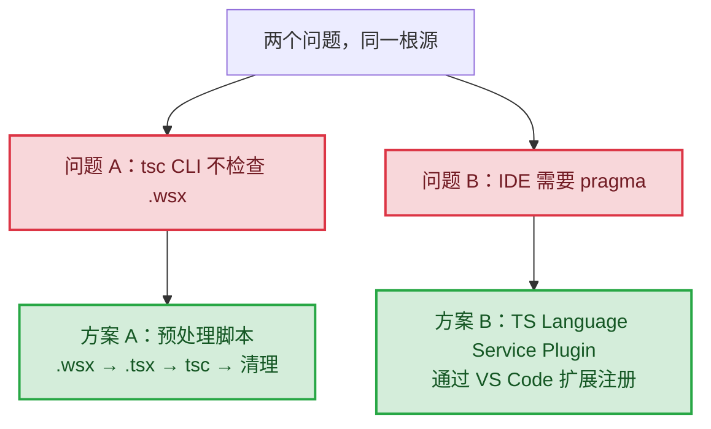
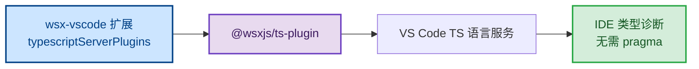
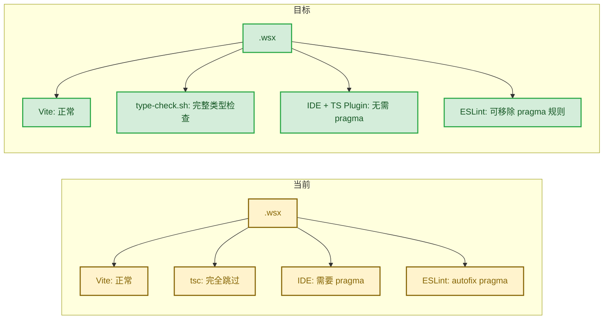

# RFC 0062: Developer Experience & IDE/TypeScript 工具链

## 1. 概述

WSX 框架使用自定义 `.wsx` 扩展名编写组件（本质是 TSX + 装饰器）。当前 TypeScript 工具链对 `.wsx` 存在两个严重缺陷：

1. **tsc 完全不检查 `.wsx` 文件内容** — CI 无类型安全保障
2. **IDE 需要每个文件手写 `@jsxImportSource` pragma** — 开发体验差

这两个问题**来源相同**（tsc 不认识 `.wsx` 扩展名），但**解决方案完全不同**，必须分开处理。

> **注意**：`create-wsx-app` 脚手架工具不在本 RFC 范围内，将单独处理。

## 2. 问题陈述

### 2.1 核心发现（2026-02-22 实际验证）

| 工具 | 是否处理 `.wsx` 内容 | 机制 |
|------|---------------------|------|
| **tsc 命令行** | **完全不处理** | 通过 `declare module "*.wsx"` 视为不透明模块，跳过内容 |
| **VS Code IDE** | 处理 | `files.associations: *.wsx → typescriptreact` |
| **Vite** | 处理 | 自定义插件 + Babel + esbuild |
| **ESLint** | 处理 | parser 配置为 typescript + jsx |

**验证方法**：在 `Button.wsx` 中写 `const x: number = "string"`：
- tsc：**零报错**（`npx tsc --noEmit 2>&1 | grep Button.wsx` 无输出）
- IDE：报 TS2322
- `npx tsc --noEmit --listFiles | grep .wsx`：**无输出**（tsc 不包含 .wsx 文件）

### 2.2 两个独立问题，两个独立方案

**问题 A：tsc 不检查 `.wsx`（CI 层面）**

TypeScript 编译器硬编码了支持的文件扩展名（`.ts`、`.tsx`、`.jsx`、`.mts` 等）。`.wsx` 不在此列表中，tsc 直接跳过。

**关键限制**：TypeScript Language Service Plugin 只在 IDE 语言服务器中运行，`tsc` CLI **不加载 plugins 配置**。因此无法用 TS Plugin 解决 CLI 类型检查问题。

**解决方案**：预处理脚本——构建前将 `.wsx` 复制为 `.tsx`，运行标准 `tsc --noEmit`，完成后清理临时文件。`.wsx` 本身就是合法 TSX，无需任何内容转换。

**问题 B：IDE 需要 pragma（编辑器层面）**

VS Code 通过 `files.associations` 把 `.wsx` 映射为 `typescriptreact`，TS 语言服务会解析 JSX。但 tsconfig 的 `jsxImportSource` 对非标准扩展名不生效，语言服务回退到经典 `React.createElement` 模式，报 TS2874。

**解决方案**：TypeScript Language Service Plugin，通过 VS Code 扩展的 `typescriptServerPlugins` 注册，告诉 IDE 的 TS 语言服务把 `.wsx` 当 `.tsx` 处理。



### 2.3 影响范围

| 场景 | 无 pragma | 有 pragma |
|------|-----------|-----------|
| `tsc --noEmit` | 不报错（跳过） | 不报错（仍跳过） |
| VS Code IDE | TS2874 | 正常 |
| Vite 构建 | 正常 | 正常 |
| ESLint | 取决于规则 | 通过 |

**结论**：pragma 只解决 IDE 问题，tsc 无论如何都不检查 `.wsx`。**当前没有任何 CI 级别的类型保障**。

## 3. 同类框架调研

| 框架 | 扩展名 | CLI 类型检查 | IDE 支持 | 机制 |
|------|--------|-------------|---------|------|
| **Vue** | `.vue` | `vue-tsc` | Volar 扩展 | Volar（SFC 需要模板编译，必须转换） |
| **Svelte** | `.svelte` | `svelte-check` | Svelte 扩展 | svelte2tsx（需要格式转换） |
| **Astro** | `.astro` | `astro check` | Astro 扩展 | Volar（需要格式转换） |
| **SolidJS** | `.tsx` | `tsc` 原生 | 原生 | 直接用标准扩展名，无需任何处理 |
| **WSX** | `.wsx` | **无** | pragma hack | — |

**关键洞察**：Vue、Svelte、Astro 需要复杂工具链，是因为它们的文件格式**必须经过编译转换**才能变成 TypeScript 能理解的代码。WSX 不同——`.wsx` 本身就是合法的 TSX，**内容不需要任何转换**，只需让 tsc 和 IDE 认识这个扩展名即可。

## 4. 架构设计

### 4.1 包结构

```
packages/
  wsx-ts-plugin/           # TS Language Service Plugin（仅 IDE 侧）
    src/
      index.ts
    package.json

  wsx-vscode/              # VS Code 扩展（Phase 2）
    src/
      extension.ts
    syntaxes/
      wsx.tmLanguage.json
    snippets/
      wsx.json
    package.json

scripts/
  type-check.sh            # 预处理脚本（Phase 1，CI 类型检查）
```

### 4.2 Phase 1：预处理脚本（解决 CI 类型检查）

核心逻辑：`.wsx` 是合法 TSX，直接复制扩展名，让标准 `tsc` 处理。

```bash
#!/bin/bash
# scripts/type-check.sh
set -e
TEMP=$(mktemp -d)
trap "rm -rf $TEMP" EXIT

find packages -name '*.wsx' | while read f; do
  dest="$TEMP/${f%.wsx}.tsx"
  mkdir -p "$(dirname "$dest")"
  cp "$f" "$dest"
done

tsc --noEmit --project tsconfig.json
```

用户集成：

```json
{ "scripts": { "type-check": "bash scripts/type-check.sh" } }
```

> 详细技术方案见 [RFC-0065](./0065-wsx-tsc-volar-integration.md)

### 4.3 Phase 2：`@wsxjs/ts-plugin` + VS Code 扩展（解决 IDE pragma）

`@wsxjs/ts-plugin` 实现 TS Language Service Plugin 接口，通过 VS Code 扩展的 `typescriptServerPlugins` 字段注册到 IDE 的 TS 语言服务。**不通过 `tsconfig.json` 的 `plugins` 字段——那只对 IDE 有效，对 `tsc` CLI 无效。**



**功能范围：**

- TS Plugin：告诉 IDE 语言服务把 `.wsx` 当 `typescriptreact` 处理，消除 TS2874
- 语言关联：`.wsx` → 自定义 `wsx` 语言（继承 `typescriptreact`）
- 语法高亮：扩展 TSX 语法，高亮 `@state`、`@autoRegister` 装饰器
- Snippets：`wsx-web`、`wsx-light`、`wsx-state`

**发布与分发：**

- 使用 vsce 打包并发布到 VS Code Marketplace
- 完整发布流程见 [RFC-0066](./0066-vscode-extension-publishing.md)

## 5. 装饰器一致性问题

### 5.1 问题描述

`.wsx` 文件使用了两类自定义装饰器：

| 装饰器 | Babel 插件 | 转换行为 |
|--------|-----------|---------|
| `@state` | `babel-plugin-wsx-state` | 转换为 reactive proxy 赋值 |
| `@autoRegister` | `@babel/plugin-proposal-decorators` | 转换为 `customElements.define()` 调用 |

**Vite 构建时**：Babel 先转换装饰器，再由 esbuild 处理 JSX。

**tsc 检查时**：tsc 看到的是**原始代码**（含装饰器语法）。预处理脚本直接复制 `.wsx` 内容，tsc 会用 `experimentalDecorators` 解析原始装饰器。

### 5.2 评估

`@state` 不改变属性类型，只改变运行时行为，不影响类型检查。`@autoRegister` 是标准类装饰器，tsc 原生支持。**大概率不会有问题，但必须在 Phase 1 实施时验证。**

## 6. 实施计划

### Phase 1：预处理脚本（CI 类型检查）

1. 编写 `scripts/type-check.sh`
2. 在 `package.json` 中添加 `type-check` script
3. 验证装饰器一致性
4. 添加测试用例
5. 集成到 CI

### Phase 2：VS Code 扩展

1. 创建 `packages/wsx-ts-plugin`，实现 TS Language Service Plugin
2. 创建 `packages/wsx-vscode`，通过 `typescriptServerPlugins` 注册插件
3. 语言关联 + 语法高亮 + Snippets
4. 验证：无 pragma 的 `.wsx` 文件在 IDE 中无 TS2874
5. 发布到 Marketplace（流程见 RFC-0066）

## 7. 验证矩阵

### 当前状态

| 场景 | 预期 | 实际 | 状态 |
|------|------|------|------|
| `.wsx` + tsc（有/无 pragma） | 类型检查 | 完全跳过 | 未达标 |
| `.wsx` + IDE + pragma | 正常 | 正常 | 通过 |
| `.wsx` + IDE 无 pragma | 正常 | TS2874 | 未达标 |
| `.wsx` + Vite | 正常构建 | 正常构建 | 通过 |

### Phase 1 完成后

| 场景 | 预期 | 状态 |
|------|------|------|
| `.wsx` 类型错误 + `type-check` | 报错 | 待验证 |
| `.wsx` JSX 类型错误 + `type-check` | 报错 | 待验证 |
| `.wsx` `@state` 装饰器 | 无误报 | 待验证 |
| `.wsx` `@autoRegister` | 无误报 | 待验证 |

### Phase 2 完成后

| 场景 | 预期 | 状态 |
|------|------|------|
| `.wsx` + IDE（无 pragma） | 无 TS2874 | 待验证 |
| `.wsx` JSX 补全 | IntrinsicElements 正确 | 待验证 |
| 与 Vite 插件兼容 | 无冲突 | 待验证 |

## 8. 工具链全景（当前 vs 目标）



## 9. 时间线

- **Phase 1**（预处理脚本）：核心约 20 行 + 装饰器验证，半天
- **Phase 2**（VS Code 扩展）：TS Plugin + 扩展包 + Marketplace 发布，2-3 天

## 10. 参考

- [TypeScript Language Service Plugin 文档](https://github.com/microsoft/TypeScript/wiki/Writing-a-Language-Service-Plugin)
- [VS Code typescriptServerPlugins 文档](https://code.visualstudio.com/api/references/contribution-points#contributes.typescriptServerPlugins)
- [TypeScript 自定义扩展名 issue #10939](https://github.com/microsoft/TypeScript/issues/10939)
- [Publishing Extensions (VS Code)](https://code.visualstudio.com/api/working-with-extensions/publishing-extension)
- RFC-0065：[预处理脚本详细方案](./0065-wsx-tsc-volar-integration.md)
- RFC-0066：[VS Code 扩展发布流程](./0066-vscode-extension-publishing.md)
