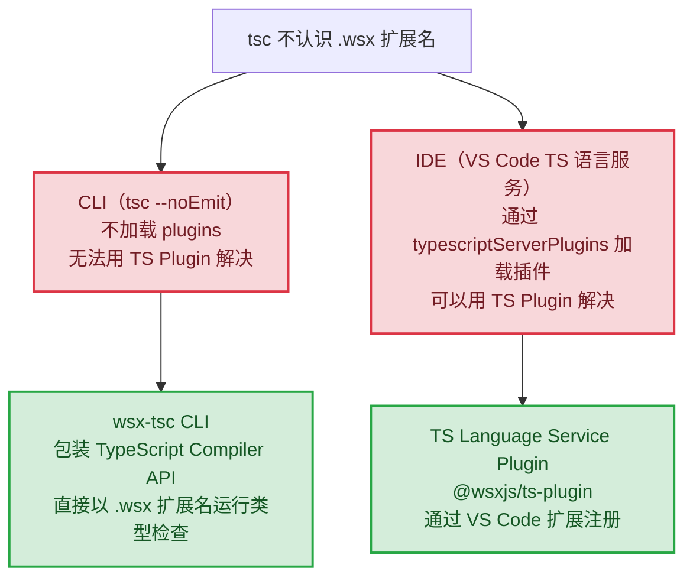
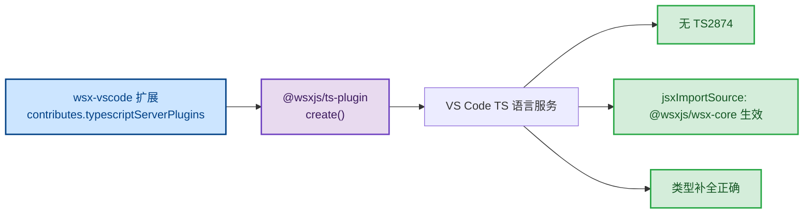

# RFC 0065: .wsx 类型检查完整方案

## 1. 概述

解决 RFC-0062 定义的两个独立问题：

| 问题 | 方案 | 包 |
|------|------|----|
| **CLI 类型检查**（`tsc` 不检查 `.wsx`） | `wsx-tsc` CLI（包装 TypeScript API） | `packages/wsx-tsc` |
| **IDE pragma 需求**（TS2874） | TS Language Service Plugin | `packages/wsx-ts-plugin` + `packages/wsx-vscode` |

**为什么不能把 `.wsx` 改成 `.tsx` 处理**：`.wsx` 使用 WSX 自己的类型系统（`WebComponent`、`LightComponent`、`@autoRegister`、`@state`），`jsxImportSource` 指向 `@wsxjs/wsx-core`。把文件当普通 TSX 处理会导致类型上下文完全错误——检查结果是假的，比不检查更危险。

**关键前提**：TypeScript Language Service Plugin **只在 IDE 语言服务器中运行，`tsc` CLI 不加载 plugins**。CLI 和 IDE 必须用两个独立方案分别解决。

## 2. 为什么是两个方案



## 3. Phase 1：`wsx-tsc` CLI（CLI 类型检查）

### 3.1 原理

直接使用 TypeScript 的 Compiler API（`typescript` 包），构建自定义的 `CompilerHost`，在 `getScriptKind()` 中把 `.wsx` 映射为 `ScriptKind.TSX`。这样 tsc 以正确的 WSX 类型上下文（`jsxImportSource: @wsxjs/wsx-core`）检查 `.wsx` 文件，不做任何内容转换。

**没有文件复制，没有临时文件，直接处理 `.wsx`。**

### 3.2 包结构

```
packages/
  wsx-tsc/
    src/
      index.ts       # CompilerHost 实现 + CLI 入口
    bin/
      wsx-tsc.js     # #!/usr/bin/env node
    package.json
    tsconfig.json
```

### 3.3 实现

```typescript
// packages/wsx-tsc/src/index.ts
import ts from 'typescript'
import { existsSync, readFileSync } from 'fs'
import { resolve, extname } from 'path'

function createWsxCompilerHost(options: ts.CompilerOptions): ts.CompilerHost {
  const host = ts.createCompilerHost(options)

  // 告诉 tsc：.wsx 文件按 TSX 语义处理（使用 WSX 的 jsxImportSource）
  const originalGetScriptKind = host.getScriptKind
  host.getScriptKind = (fileName: string): ts.ScriptKind => {
    if (fileName.endsWith('.wsx')) return ts.ScriptKind.TSX
    return originalGetScriptKind
      ? originalGetScriptKind(fileName)
      : ts.ScriptKind.Unknown
  }

  return host
}

export function run(tsconfigPath: string = 'tsconfig.json'): void {
  const configFile = ts.readConfigFile(tsconfigPath, ts.sys.readFile)
  if (configFile.error) {
    console.error(ts.flattenDiagnosticMessageText(configFile.error.messageText, '\n'))
    process.exit(1)
  }

  const parsed = ts.parseJsonConfigFileContent(
    configFile.config,
    ts.sys,
    process.cwd()
  )

  // 确保 .wsx 文件被纳入编译范围
  const wsxFiles = ts.sys.readDirectory(
    process.cwd(),
    ['.wsx'],
    parsed.raw?.exclude,
    parsed.raw?.include
  )
  const allFiles = [...parsed.fileNames, ...wsxFiles]

  const host = createWsxCompilerHost(parsed.options)
  const program = ts.createProgram(allFiles, parsed.options, host)
  const diagnostics = ts.getPreEmitDiagnostics(program)

  if (diagnostics.length > 0) {
    const formatted = ts.formatDiagnosticsWithColorAndContext(
      Array.from(diagnostics),
      host
    )
    process.stderr.write(formatted)
    process.exit(1)
  }
}
```

```javascript
// packages/wsx-tsc/bin/wsx-tsc.js
#!/usr/bin/env node
import { run } from '../dist/index.js'
run()
```

### 3.4 依赖关系

```
packages/wsx-tsc
  └─ typescript >=5.0.0 (peer，复用项目已有的 tsc)
```

零额外依赖。

### 3.5 用户集成

```json
{
  "scripts": {
    "type-check": "wsx-tsc"
  }
}
```

`tsconfig.json` 无需修改，`wsx-tsc` 直接读取项目现有配置并以正确的 WSX 类型上下文检查 `.wsx` 文件。

CI 中：

```bash
pnpm type-check
```

## 4. Phase 2：TS Language Service Plugin（IDE 支持）

### 4.1 原理

VS Code 扩展通过 `contributes.typescriptServerPlugins` 向 IDE 内置的 TS 语言服务注册插件。插件在 `create()` 中拦截 `getScriptKind`，告诉语言服务把 `.wsx` 当 `typescriptreact` 处理，消除 TS2874，让 `jsxImportSource: @wsxjs/wsx-core` 生效，无需每个文件写 pragma。

> **注意**：此插件**只在 IDE 里运行**，不影响 `tsc` CLI。CLI 类型检查必须用 Phase 1 的 `wsx-tsc`。

### 4.2 包结构

```
packages/
  wsx-ts-plugin/
    src/
      index.ts       # 实现 create() 函数
    package.json

  wsx-vscode/
    package.json     # 通过 typescriptServerPlugins 注册插件
```

### 4.3 `@wsxjs/ts-plugin` 实现

```typescript
// packages/wsx-ts-plugin/src/index.ts
import type ts from 'typescript/lib/tsserverlibrary'

function create(info: ts.server.PluginCreateInfo) {
  const proxy = Object.create(null)
  const ls = info.languageService

  for (const k of Object.keys(ls) as (keyof ts.LanguageService)[]) {
    (proxy as any)[k] = (...args: any[]) => (ls as any)[k](...args)
  }

  // .wsx → TSX：让 IDE 语言服务以 WSX 的 jsxImportSource 语义解析 .wsx 文件
  proxy.getScriptKind = (fileName: string): ts.ScriptKind => {
    if (fileName.endsWith('.wsx')) return info.typescript.ScriptKind.TSX
    return ls.getScriptKind?.(fileName) ?? info.typescript.ScriptKind.Unknown
  }

  return proxy
}

export = { create }
```

依赖：

```
@wsxjs/ts-plugin
  └─ typescript >=5.0.0 (peer)
```

零额外依赖。

### 4.4 VS Code 扩展注册

```json
{
  "contributes": {
    "typescriptServerPlugins": [{
      "name": "@wsxjs/ts-plugin",
      "enableForWorkspaceTypeScriptVersions": true
    }]
  }
}
```

**不通过 `tsconfig.json` 的 `plugins` 字段**——那个字段只对 IDE 语言服务有效，对 `tsc` CLI 无效，容易造成误解。



## 5. 装饰器一致性

| 装饰器 | Babel 插件 | 转换行为 | tsc/wsx-tsc 检查时行为 |
|--------|-----------|---------|----------------------|
| `@state` | `babel-plugin-wsx-state` | 转为 reactive proxy | `experimentalDecorators` 解析，属性类型不变，无误报风险 |
| `@autoRegister` | `@babel/plugin-proposal-decorators` | 转为 `customElements.define()` | 标准类装饰器，`experimentalDecorators` 原生支持 |

**必须在 Phase 1 实施时验证。** 如果发现误报，在 `createWsxCompilerHost` 中对 `.wsx` 文件的 snapshot 做预处理。

## 6. 实施检查清单

### Phase 1（wsx-tsc CLI）

1. [ ] 创建 `packages/wsx-tsc` 包骨架
2. [ ] 实现 `createWsxCompilerHost`（拦截 `getScriptKind`）
3. [ ] 实现 `run()` 函数（读取 tsconfig，收集 `.wsx` 文件，运行诊断）
4. [ ] 添加 `bin/wsx-tsc.js` CLI 入口
5. [ ] 验证装饰器一致性：
   - [ ] `@state` 无误报
   - [ ] `@autoRegister` 无误报
   - [ ] JSX 类型错误被捕获
   - [ ] 普通 TS 类型错误被捕获
6. [ ] 添加测试用例
7. [ ] 集成到 CI（GitHub Actions）

### Phase 2（TS Plugin + VS Code 扩展）

8. [ ] 创建 `packages/wsx-ts-plugin`
9. [ ] 实现 `create()` 函数
10. [ ] 创建 `packages/wsx-vscode`
11. [ ] 在扩展 `typescriptServerPlugins` 注册插件
12. [ ] 验证：无 pragma 的 `.wsx` 在 IDE 中无 TS2874
13. [ ] 验证：JSX 补全包含正确的 IntrinsicElements（来自 `@wsxjs/wsx-core`）
14. [ ] 发布到 Marketplace（流程见 RFC-0066）

## 7. 验证矩阵

| 测试场景 | 方案 | 输入 | 预期输出 | 优先级 |
|----------|------|------|---------|--------|
| TS 类型错误 | wsx-tsc | `const x: number = "str"` | 报 TS2322 | P0 |
| JSX 类型错误 | wsx-tsc | `<div unknownProp={1} />` | 报错 | P0 |
| 正确代码 | wsx-tsc | 现有 Button.wsx | 零错误 | P0 |
| `@state` 装饰器 | wsx-tsc | `@state private count = 0` | 无误报 | P0 |
| `@autoRegister` | wsx-tsc | `@autoRegister({tagName:'x'})` | 无误报 | P0 |
| IDE 无 pragma | TS Plugin | 任意 .wsx 文件 | 无 TS2874 | P0 |
| import .wsx | wsx-tsc | `import Button from './Button.wsx'` | 类型正确 | P1 |
| 跨文件类型推导 | wsx-tsc | `.ts` 中 import `.wsx` 调用错误 prop | 报 TS2322 | P1 |
| JSX 补全 | TS Plugin | IntrinsicElements | 包含 WSX intrinsic elements | P1 |

## 8. 时间线

- **Phase 1**（`wsx-tsc`）：CompilerHost 约 50 行 + 验证，1 天
- **Phase 2**（TS Plugin + VS Code 扩展）：插件实现 + 扩展配置 + 发布，2-3 天

## 9. 参考

- [TypeScript Compiler API](https://github.com/microsoft/TypeScript/wiki/Using-the-Compiler-API)
- [TypeScript Language Service Plugin 文档](https://github.com/microsoft/TypeScript/wiki/Writing-a-Language-Service-Plugin)
- [VS Code typescriptServerPlugins](https://code.visualstudio.com/api/references/contribution-points#contributes.typescriptServerPlugins)
- [TypeScript 自定义扩展名 issue #10939](https://github.com/microsoft/TypeScript/issues/10939)
- 父 RFC：[RFC-0062 DX & IDE 工具链](./0062-dx-and-vscode-support.md)
- 发布流程：[RFC-0066 VS Code 扩展发布](./0066-vscode-extension-publishing.md)
