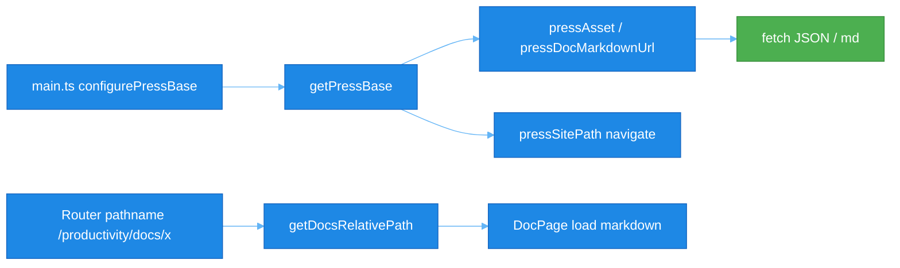

# RFC 0067: wsx-press 可配置站点 Base（子路径部署）

## 1. 概述

`@wsxjs/wsx-press` client 与 dev middleware 当前**硬编码根路径**（`/.wsx-press/`、`/docs/`、`path.startsWith("/docs/")` + `slice(6)`）。站点部署在 **非根 base**（如 GitHub Pages 项目站 `https://org.github.io/productivity/` → Vite `base: /productivity/`）时，文档元数据、Markdown、搜索索引、侧边栏导航全部 404。

本 RFC 要求在 **wsx-press 源码** 引入可配置、默认 `/` 的 base 路径层，消除下游应用对 Vite 编译期 string-replace 的依赖。

**黄金法则 (Golden Rules)**:

- **100% 测试覆盖率是强制要求**：`packages/wsx-press/src/client/paths.ts` 及所有改动路径必须达到 lines / functions / branches / statements 100%。
- **默认行为不变**：未调用 `configurePressBase` 时，行为与现网一致（base = `/`）。

## 2. 动机

### 2.1 问题现象

部署到 `https://luban-ws.github.io/productivity/` 时：

| 请求 | 期望 | 实际（当前） |
|------|------|--------------|
| `/.wsx-press/docs-meta.json` | `/productivity/.wsx-press/docs-meta.json` | 404 |
| `/docs/guide/intro.md` | `/productivity/docs/guide/intro.md` | 404 |
| 侧边栏 `RouterUtils.navigate("/docs/...")` | `/productivity/docs/...` | 路由不匹配 |

Vite 构建产物（`index.html`、bundle）已正确带 `base`，**仅 wsx-press client 仍请求根路径**。

### 2.2 根因

| 层级 | 问题 |
|------|------|
| **wsx-press client** | fetch / navigate 写死 `/` |
| **wsx-press node plugin** | dev middleware 挂载在 `/.wsx-press`，未读 `config.base` |
| **路径解析** | `slice(6)` 假设 pathname 以 `/docs/` 开头，无法处理 `/productivity/docs/...` |

### 2.3 错误方向（禁止作为长期方案）

下游应用在 Vite 中对 `@wsxjs/wsx-press/client` 预构建产物做 **编译期字符串替换**（`wsxPressBasePlugin`）。问题：

- 补丁 consumer，非修复 library
- 预构建 dist 内 `import.meta.env.BASE_URL` 在 library build 时已固化为 `/`
- 每增一处硬编码路径就要改 regex，不可维护

**正确修复位置：`packages/wsx-press`。**

## 3. 目标

1. **默认根路径**：零配置时与 today 行为一致。
2. **可变更 base**：应用可在启动时设置任意 Vite 兼容 base（`/productivity/` 等）。
3. **统一路径 API**：client 组件不再直接拼接 `"/.wsx-press/"` 或 `"/docs/"`。
4. **dev / prod 一致**：开发服务器 middleware  respect `config.base`。
5. **向后兼容**：metadata 中 `route` 字段保持**应用内路由**（`/docs/...`，不含 base）；仅在 fetch / History API 时加 base。

## 4. 范围

### In-Scope

- 新增 `packages/wsx-press/src/client/paths.ts`
- 修改 client 组件：`DocPage`、`DocSidebar`、`DocSearch`、`DocTOC`
- 修改 `packages/wsx-press/src/node/plugin.ts` dev middleware
- 单元测试 + 更新现有 component tests
- 从 `@wsxjs/wsx-press/client` 导出 public API
- 文档：集成指南（GitHub Pages / 子路径部署）

### Out-of-Scope

- **wsx-router base 感知**（见 §8 后续工作）：本 RFC 不修改 router；consumer 继续用 `sitePath()` 注册 `wsx-view route`。
- metadata 生成格式变更（`route` 仍为 `/docs/...`）
- TypeDoc / search index schema 变更
- 自动从 DOM 猜测 base（可选增强，非 MVP）

## 5. 详细设计

### 5.1 核心 API（`client/paths.ts`）

```typescript
/** 应用内文档路由前缀（不含站点 base） */
export const DOCS_ROUTE_PREFIX = "/docs";

/** 显式配置 base；未配置时默认 `/` */
export function configurePressBase(base: string): void;

/** 测试用：重置为默认 `/` */
export function resetPressBase(): void;

/** 当前 base，默认 `/` */
export function getPressBase(): string;

/** 应用内路由 → 带 base 的 pathname，如 `/docs/x` → `/productivity/docs/x` */
export function pressSitePath(route: string): string;

/** wsx-press 静态 JSON，如 `docs-meta.json` → `{base}.wsx-press/docs-meta.json` */
export function pressAsset(relativePath: string): string;

/** Markdown URL，如 `guide/intro` → `{base}/docs/guide/intro.md` */
export function pressDocMarkdownUrl(docPath: string): string;

/** 从完整 pathname 剥离 base，得到应用内路由 */
export function stripPressBase(pathname: string): string;

/** 从 pathname 提取文档相对路径；非文档页返回 null */
export function getDocsRelativePath(pathname: string): string | null;
```

**设计原则**：

- **默认 `/`**：`configuredBase === null` → `getPressBase()` 返回 `/`。
- **显式配置优先**：应用入口调用 `configurePressBase(import.meta.env.BASE_URL)`。
- **不假设永远根部署**：禁止新增 `startsWith("/docs/")` + 魔法数字 `slice(6)`；统一 `getDocsRelativePath`。
- **metadata.route 语义不变**：仍为 `/docs/guide/intro`；比较时用 `stripPressBase(currentPath) === doc.route`；导航时用 `pressSitePath(doc.route)`。

### 5.2 规范化规则

```typescript
normalizeSiteBase("/")           → "/"
normalizeSiteBase("/productivity") → "/productivity/"
normalizeSiteBase("productivity/") → "/productivity/"
```

与 Vite `base` 选项一致（trailing slash）。

### 5.3 Client 组件改动

| 文件 | 改动 |
|------|------|
| `DocPage.wsx` | `loadMetadata` → `pressAsset("docs-meta.json")`；Markdown → `pressDocMarkdownUrl(docPath)`；解析路径 → `getDocsRelativePath(routeInfo.path)` |
| `DocSidebar.wsx` | fetch 同上；`href` / `navigate` → `pressSitePath(doc.route)`；`isCurrentDoc` → `stripPressBase(currentRoute) === route` |
| `DocSearch.wsx` | `pressAsset("search-index.json")` |
| `DocTOC.wsx` | `pressAsset("docs-toc.json")`；TOC 文档 key → `getDocsRelativePath` |

### 5.4 Node Plugin（dev middleware）

当前：

```typescript
server.middlewares.use("/.wsx-press", handler);
```

改为读取 `config.base`：

```typescript
const mountPath = `${normalizeBase(config.base)}/.wsx-press`.replace(/\/+/g, "/");
// base="/" → "/.wsx-press"
// base="/productivity/" → "/productivity/.wsx-press"
server.middlewares.use(mountPath, handler);
```

`buildStart` 输出目录逻辑不变（仍写入项目根 `.wsx-press`）；consumer 负责 copy 到 `dist`（现有模式）。

### 5.5 Consumer 集成

```typescript
// main.ts — 尽早调用
import { configurePressBase } from "@wsxjs/wsx-press/client";
configurePressBase(import.meta.env.BASE_URL);
```

```tsx
// App.wsx — router 仍由应用负责 base（本 RFC 范围外）
<wsx-view route={sitePath("/docs/*")} component="doc-section" />
```

移除 consumer 侧 `wsxPressBasePlugin` 及对应测试。

### 5.6 数据流（子路径部署）



## 6. 非目标与约束

- **Library 预构建 dist**：`import.meta.env.BASE_URL` 在 wsx-press 打包时为 `/`，**不能**单独依赖 compile-time 注入；必须 runtime `configurePressBase` 或等价机制。
- **双配置**：若应用已有 `sitePaths.ts`，wsx-press 与 app 层各自维护 base 配置，但值必须相同（均来自 `import.meta.env.BASE_URL`）。长期可考虑 wsx-press  re-export 或共享 `@wsxjs/site-paths` 包——**不在本 RFC**。

## 7. 成功标准

1. `configurePressBase("/productivity/")` 后，所有 client fetch URL 带 `/productivity/` 前缀。
2. 未调用 `configurePressBase` 时，现有测试零改动通过（或仅 import paths reset）。
3. `pnpm --filter @wsxjs/wsx-press test -- --coverage`：`paths.ts` 100% 覆盖率。
4. luban-ws/productivity 移除 `wsxPressBasePlugin` 后，`pnpm build:pages` + GitHub Pages 文档页可加载。
5. dev：`vite base=/productivity/` 时 `/.wsx-press/*` 改为 `/productivity/.wsx-press/*` 可访问。

## 8. 后续工作（可选 RFC）

| 项 | 说明 |
|----|------|
| **RFC-00XX wsx-router base** | `WsxRouter` 使用 `window.location.pathname` 全路径，而 `wsx-view route="/docs/*"` 不含 base；today consumer 用 `sitePath()` 注册。router 内置 base 可消除双处配置。 |
| **DocSearch 导航** | `doc-search-select` 事件 `route` 仍为应用内路径；listener 需 `pressSitePath` 或 router base。 |
| **自动 configure** | client entry 读取 `<base href>` 或首屏 script src 推断 base（零显式调用）。风险：SSR / 测试环境需 fallback。 |

## 9. 实施计划

### 阶段一：paths 模块

| 步骤 | 内容 | 完成标准 |
|------|------|----------|
| 1.1 | 添加 `src/client/paths.ts` | API 如上 |
| 1.2 | `src/client/__tests__/paths.test.ts` | 100% coverage；覆盖 `/` 与 `/productivity/` |
| 1.3 | `client/index.ts` export paths | 类型可导入 |

### 阶段二：client 组件

| 步骤 | 内容 | 完成标准 |
|------|------|----------|
| 2.1 | 改 DocPage / DocSidebar / DocSearch / DocTOC | 无硬编码 `/.wsx-press/`、`slice(6)` |
| 2.2 | 更新 `DocPage.test.ts`、`DocSearch.test.ts` | `beforeEach` → `resetPressBase()`；增 subpath 用例 |
| 2.3 | `pnpm --filter @wsxjs/wsx-press test` | 全绿 |

### 阶段三：node plugin

| 步骤 | 内容 | 完成标准 |
|------|------|----------|
| 3.1 | `plugin.ts` middleware 读 `config.base` | plugin.test 覆盖 subpath mount |
| 3.2 | 文档说明 dev 行为 | site 或 package README |

### 阶段四：发布与 consumer

| 步骤 | 内容 | 完成标准 |
|------|------|----------|
| 4.1 | 发版 `@wsxjs/wsx-press` minor bump | changelog |
| 4.2 | productivity bump + `configurePressBase` + 删 plugin | GH Pages 验证 |
| 4.3 | RFC 状态 → Implemented | PR 合并 |

## 10. 测试矩阵

| 场景 | base | pathname | pressAsset("docs-meta.json") | getDocsRelativePath |
|------|------|----------|------------------------------|---------------------|
| 默认 | `/` | `/docs/a/b` | `/.wsx-press/docs-meta.json` | `a/b` |
| GH Pages | `/productivity/` | `/productivity/docs/a/b` | `/productivity/.wsx-press/docs-meta.json` | `a/b` |
| 自定义 | `/app/v2/` | `/app/v2/docs/x` | `/app/v2/.wsx-press/docs-meta.json` | `x` |
| 非文档 | `/productivity/` | `/productivity/` | — | `null` |

## 11. 风险

| 风险 | 缓解 |
|------|------|
| 忘记调用 `configurePressBase` | 文档 + site 模板；可选 dev warning |
| 与 app `sitePath` 双配置不一致 | 集成指南强调同一 `BASE_URL` |
| 预构建 dist 无法 tree-shake paths | paths 模块极小，可接受 |

## 12. 开放问题（待 Review）

1. **Public API 命名**：`configurePressBase` vs `setBaseUrl` vs `initPress({ base })`？
2. **是否 export `normalizeSiteBase`** 供 node plugin 复用（避免 duplicate）？
3. **minor vs patch**：仅 additive API + bugfix 性质 → 发布 **patch** `0.1.2`。
4. **wsx-router base** 是否与本 RFC 同批实现，还是单独 RFC？

## 13. 变更历史

- 2026-07-11: 初稿（Proposed），来自 luban-ws/productivity GitHub Pages 部署实践与 wsxPressBasePlugin workaround 复盘。
- 2026-07-11: Implemented — `client/paths`, `shared/site-base`, 组件与 dev middleware；`@wsxjs/wsx-press@0.1.2` 导出 `./client/paths`。

---

**Review 请求**：请 wsxjs 维护者确认 API 形状、范围边界（router 是否纳入）、发布节奏。Accept 后按 §9 实施并关闭 consumer 侧 compile-time patch。
